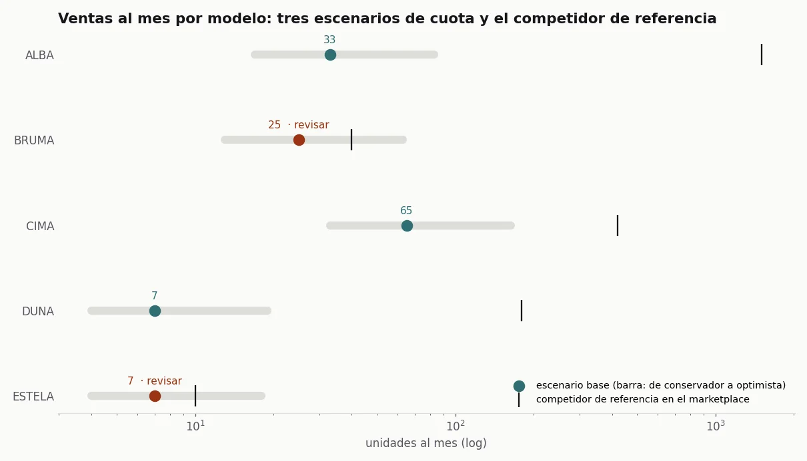
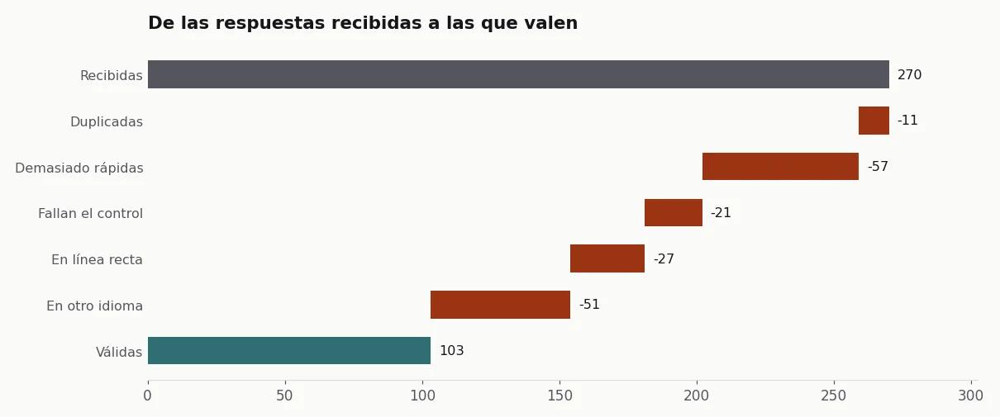
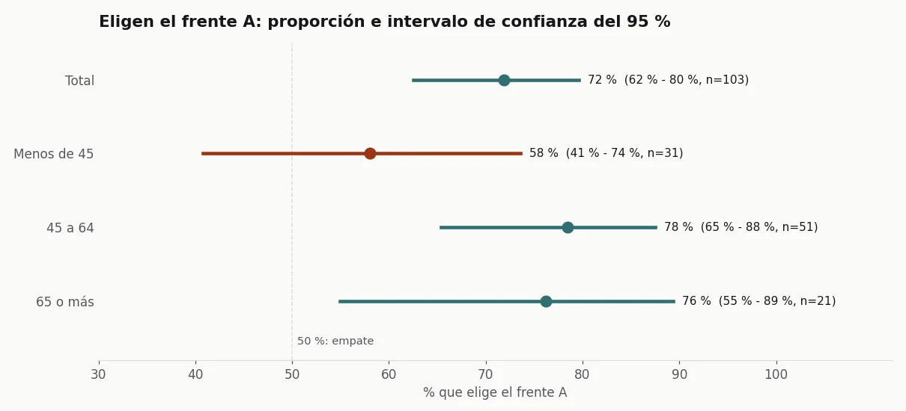

## El problema

En 2026 Garza preparaba una gama nueva de cámaras de vigilancia wifi, cada modelo pensado para un
tipo de comprador. Antes de lanzarla había que contestar dos preguntas que no admiten "ya
veremos": cuántas unidades pedir de cada modelo al proveedor, con los meses de stock de seguridad
que fija compras, y qué frente de caja funciona mejor en el lineal.

No había ventas propias de esos modelos, porque no existían. Lo que había eran datos de mercado
que no son tuyos (un panel de ventas de tiendas físicas y los más vendidos de un marketplace) y la
posibilidad de preguntar a consumidores.

## La solución

**La demanda, por segmento y de arriba abajo.** Para cada modelo:

1. Del panel de tiendas, las ventas del mismo tipo de cámara en el mismo rango de precio, afinadas
   por resolución y alimentación donde el panel lo permite.
2. Como el panel no cubre todas las tiendas, el offline se corrige con un factor de cobertura. Es el
   supuesto más débil, así que va a la vista como parámetro y no escondido en una fórmula.
3. Del marketplace, el mismo pasillo y rango de precio. Ahí no hay características técnicas, y no se
   puede afinar más.
4. Tres escenarios de cuota sobre el mercado del segmento (conservador, base y optimista), en vez
   de una cifra que esconde la incertidumbre. Dos modelos propios en el mismo segmento se reparten
   la cuota; si no, la marca se cuenta dos veces el mismo mercado.
5. El pedido: ventas al mes del escenario por los meses de stock de seguridad.
6. Un contraste: las ventas del escenario base frente a las del competidor de referencia en el
   marketplace. Si el modelo pide vender más de la mitad de lo que vende ese competidor, se
   revisa a mano.

**El consumidor, con una encuesta que había que limpiar antes de contar.** La encuesta incluía un
test A/B de dos frentes de caja. El panel online era barato y trajo mucha basura: bots que
contestaban en segundos, respuestas en otro idioma, gente que contestaba todo igual. Más de la
mitad de las respuestas no valían. La limpieza tiene que ir antes que cualquier porcentaje, y cada
respuesta descartada se queda con su motivo para que se pueda auditar.

Además partí de buyer personas tratadas como hipótesis, porque salían de fuentes secundarias y no
de medición propia, y crucé persona por tipo de cámara para priorizar qué modelos desarrollar
primero.

## Resultado

Las cifras del estudio real se quedan en Imprex, y los datos de mercado tienen licencia. Lo he
rehecho sobre datos sintéticos con la misma forma: un panel, un marketplace, cinco modelos
inventados y 270 respuestas de encuesta con su basura.

*Datos sintéticos, generados con el [código del caso](https://github.com/acamposla/lanzamiento-camaras).*

El contraste marca dos modelos. En los dos, el competidor de referencia vende muy poco para el
tamaño de su segmento: o es un nicho que nadie ha ocupado, o el competidor elegido no es el que
manda. En ninguno de los dos casos la cuota de mercado es buena guía, y el pedido se decide con
criterio y no con la fórmula.

Con las respuestas válidas, el frente A gana con claridad en total. Por edades, el intervalo
cuenta lo que el porcentaje solo no dice: entre los menores de 45, con 31 respuestas, el intervalo
baja del 50 % y no se puede afirmar que gane. Con ese tamaño de muestra, la decisión de packaging
se apoya en los grupos donde el resultado es claro, y el resto se dice.

En el estudio real entregué el análisis de mercado, la estimación de pedido por modelo, la
priorización del surtido, el informe de la encuesta y la presentación para ventas. Quedó
pendiente repetir la encuesta con un panel de más calidad, filtrado por idioma y país desde el
origen.

Cómo está hecho, para quien quiera el detalle técnico

- **Rangos de precio:** cortes fijos (<25, 25-35, 35-50, 50-75, 75-100, 100+ €), iguales para el
  panel y el marketplace, para que los dos segmentos sean comparables.
- **Escenarios de cuota:** 1 %, 2 % y 5 % del mercado del segmento, repartidos a partes iguales
  entre los modelos propios que lo comparten.
- **Contraste:** se marca el modelo cuyo escenario base supera la mitad de las ventas del
  competidor de referencia.
- **Limpieza de la encuesta:** cinco reglas en orden (duplicado por huella, menos de un tercio de
  la duración mediana, fallo en la pregunta de control, matriz en línea recta y texto libre en otro
  idioma); la respuesta que cae guarda el primer motivo.
- **Test A/B:** intervalo de confianza de Wilson al 95 %, en total y por edad.
- **Código:** [acamposla/lanzamiento-camaras](https://github.com/acamposla/lanzamiento-camaras),
  con 21 tests y los gráficos exportables en español o en inglés.

