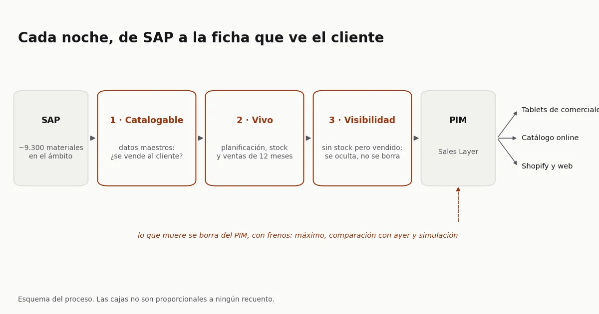

## El problema

Imprex distribuye marcas de terceros y tiene las suyas propias, Garza entre
ellas, y vende por varios canales: las tablets de los comerciales, el catálogo
online y Shopify, entre otros. Todos beben de un PIM, Sales Layer, que a su vez
tendría que beber de SAP.

En la práctica, decidir qué productos aparecían en cada catálogo era manual y
dependía de quién lo hiciera. No había una regla que dijera "este producto
tiene stock para estar" o "este ya no se fabrica, hay que quitarlo". Cada
responsable de marca aplicaba su propio criterio. El resultado se veía desde
fuera: productos agotados que seguían en el catálogo, productos nuevos que
tardaban semanas en aparecer, y miles de fichas en el PIM de productos que SAP
ya daba por retirados.

Quienes más lo sufrían eran ventas, que vendía con ese catálogo, y marketing,
que lo mantenía.

El problema técnico era el menor. Lo difícil era que las reglas no estaban
escritas en ningún sitio: qué cuenta como un producto vendible, qué hacer con
uno que se queda sin stock pero se vendió hace dos meses, qué pasa cuando el
mismo código de barras tiene tres códigos de SAP.

## La solución

**Primero, escribir las reglas.** Antes de una línea de código, puse por
escrito qué hace que un producto sea catalogable: que sea de un sector que
comercializamos, que sea un tipo de artículo que se vende, que tenga código de
barras y que no sea una pieza suelta de un expositor. Algunas de esas reglas
las tuve que confirmar con IT campo a campo, porque el nombre de un campo de
SAP no siempre significa lo que parece.

**Después, un embudo de capas que corre solo.** De los cerca de 9.300 materiales de
SAP que entran en el ámbito, el proceso decide cada noche:

1. **Catalogable:** si el producto es relevante para algún catálogo, solo con
   datos maestros. Aquí se queda fuera todo lo que no se vende al cliente:
   servicios, conceptos de facturación, material sin código de barras.
2. **Vivo:** si está disponible para vender, con datos reales de planificación,
   stock y ventas de los últimos doce meses.
3. **Visible u oculto:** un producto que se queda sin stock pero se ha vendido
   en el último año no se borra, se oculta. Así no se pierde el trabajo que
   marketing ha hecho en su ficha (fotos, textos, atributos), y vuelve a
   aparecer cuando repone.
4. **Publicación:** lo vivo viaja al PIM cada noche. Lo que muere se borra del
   PIM comparando lo que hay allí con la lista de vivos.

Dos decisiones de diseño que importan fuera del código. El cálculo se hace por
código de barras y no por código de SAP, porque un mismo producto puede tener
varios códigos de SAP sustitutivos y para el cliente es uno solo. Y el borrado
lleva frenos: no actúa si la lista a borrar pasa de un máximo o si cambia
demasiado respecto al día anterior, y por defecto solo simula. Un error en el
origen no puede vaciar el catálogo en una noche.

**Por último, repartir quién decide qué.** La automatización quita trabajo
repetitivo, pero no quita decisiones. Escribí un documento de gobierno que
dice qué hace y qué no hace cada uno: IT mantiene las réplicas de SAP y la
máquina; logística, los datos maestros que entran; cada responsable de marca,
el enriquecimiento de sus fichas y en qué canal va cada producto; y yo, como
responsable del PIM, las reglas y el proceso. Sin ese reparto, las incidencias
caen en el equipo equivocado y las tareas críticas no las hace nadie.

La prueba llegó con las primeras quejas. Los responsables de marca me pasaron
una tanda de productos que el proceso iba a quitar y que, según ellos, tenían
que seguir. Los revisé uno a uno y solo un par eran fallos del proceso. El
resto eran productos marcados para borrar en SAP que la marca quería mantener,
productos sin stock ni reposición, alguno sin código de barras, y unos cuantos
que ya estaban en el catálogo. Lo que propuse a dirección no fue tocar el
código sino el circuito: un árbol de decisión para que cada responsable viera
por qué un producto no aparece y a quién dirigirse, y un informe por marca con
el estado de cada producto explicado en lenguaje claro.

Donde más costó fue en los equipos que llevaban marcas de terceros. Muchos
fabricantes tienen su propio PIM, y esos equipos consultaban allí la ficha del
producto en lugar de enriquecerla en el nuestro. Tenía su lógica: la
información ya existía. Pero el PIM del fabricante no sabe qué stock tenemos,
a qué precio lo vendemos ni en qué canal va cada producto, y un distribuidor
vende con su catálogo, no con el del fabricante. Con algunas marcas se
resolvió del todo y sus fichas pasaron a enriquecerse en nuestro PIM; en
Garza, la marca que llevaba yo, también. Con otras no llegó a resolverse.

## Resultado

En abril de 2026 el proceso pasó de mi portátil a una máquina de la empresa y
empezó a correr solo cada noche: SAP vuelca sus tablas, el proceso recalcula el
estado de cada producto y publica en el PIM, y más tarde otro paso borra lo que
ha muerto. La gestión manual de qué productos aparecen desapareció para todo
el catálogo vendible. Cuando salí de la empresa, a finales de abril,
seguía corriendo cada noche sin que nadie lo tocara.

El PIM pasó a ser la fuente de los canales: las tablets de los comerciales, el
catálogo online y [garza.es](https://garza.es/), la web de Garza en Shopify,
que monté para que tirara directamente del PIM. Una ficha que se enriquece una
vez llega a todos.

Los catálogos impresos dejaron de montarse a mano. Con el plugin de EasyCatalog,
InDesign lee directamente del PIM, y enseñé a los diseñadores a conectarse y a
usar marcadores y filtros que aplican las mismas reglas de negocio: las del
proceso que carga el PIM y las que viven en el propio PIM. Con eso, un
diseñador saca el catálogo de una marca o de un cliente sin pedirle los datos
a nadie.

Quedaba decidir qué producto va en qué canal. Una regla ya corría en
producción: hay canales que solo quieren productos con cobertura, así que un
producto que no se planifica solo entra si tiene al menos tres meses de stock
al ritmo de venta del último año. La exclusividad por cliente o por tipo de
tienda la dejé especificada como una cascada (primero la regla del producto, si
no la de la marca, si no la de la empresa), con las reglas en una tabla que
gestiona negocio para que un canal nuevo no obligue a tocar código. Cuando salí
estaba pendiente de la decisión comercial sobre exclusividades.

Por el camino salió lo que la gestión manual escondía: cientos de materiales
sin código de barras que inflaban la cifra de catalogables sin llegar nunca a
un catálogo, piezas de expositor que no se venden sueltas, y miles de fichas
en el PIM de productos que ya no existían.

La parte técnica fue la fácil. Lo que más costó fue escribir reglas de negocio
que hasta entonces vivían en la cabeza de la gente, y conseguir que cada
departamento aceptara la parte que le tocaba.

Esta experiencia es la base del servicio de catálogo que ofrezco ahora en
[Sapioverse](https://sapioverse.es/es/casos/catalogo-imprex/).

Cómo está montado, para quien quiera el detalle técnico

- **Origen:** SAP S/4HANA, replicado cada tarde en Oracle por IT.
- **Capa 1, catalogable:** vista materializada en Oracle con los filtros de
  datos maestros (sector, tipo de artículo, categoría, código de barras, pieza
  de expositor y centro). Una pared en la propia consulta impide que un
  producto no catalogable llegue a la capa 2.
- **Capa 2, vivo:** ETL en Python que cruza planificación, stock y ventas de
  doce meses por código de barras, con tablas de sustitutivos. Adaptado a la
  migración a S/4HANA, que cambió de tabla los movimientos de material.
- **Publicación:** exportación diaria al PIM por FTP, y borrado por API
  comparando el PIM con la lista de vivos, con umbral máximo, comparación con
  el día anterior y modo de simulación por defecto.
- **Orquestación:** un script diario con orden de dependencias (cálculo,
  refresco de la vista, exportación) en una máquina Linux de la empresa, con
  cron.
- **Pruebas:** tests unitarios del cálculo de cobertura.
- **Código:** el original es de Imprex y no se publica. Las reglas están
  reescritas sobre un catálogo sintético en
  [acamposla/catalogo-vivo](https://github.com/acamposla/catalogo-vivo), con la
  capa 1 en SQL, la capa 2, la conciliación con sus frenos y 29 tests.
- **Lo que quedó pendiente al salir:** la limpieza masiva inicial del PIM,
  a falta de la validación de marketing, y una tercera capa de catálogos por
  canal, que necesitaba una decisión de negocio sobre exclusividades.

