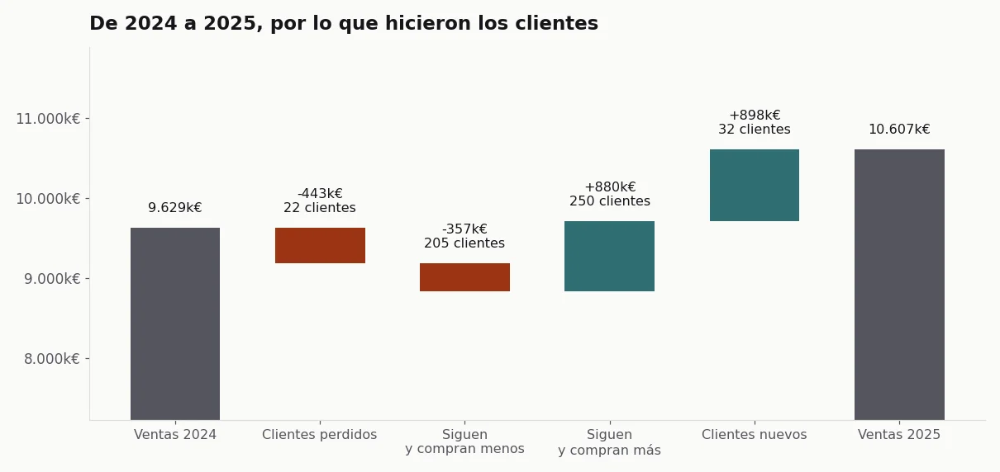
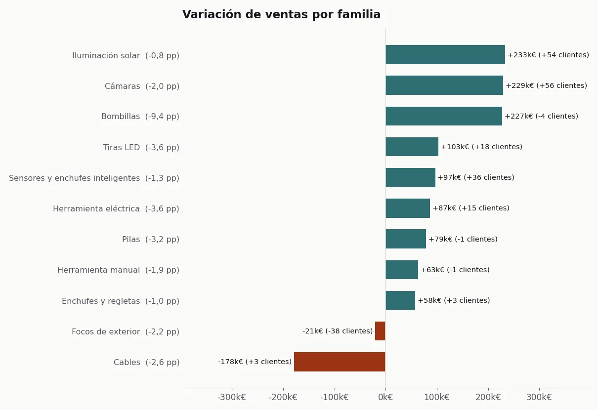
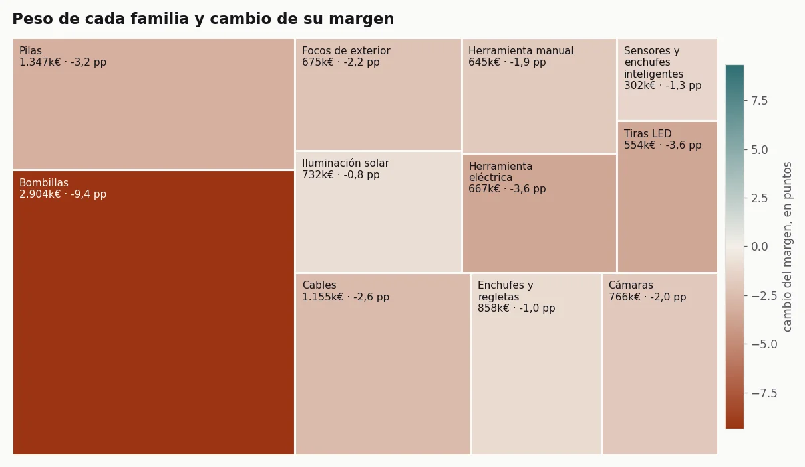
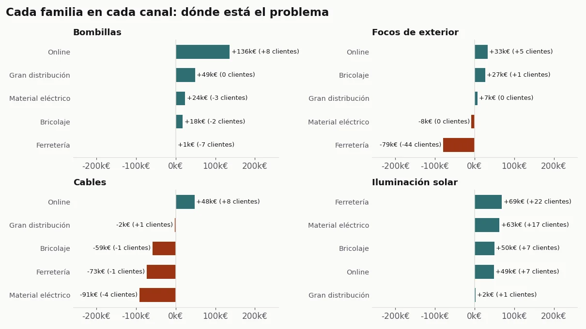

## El problema

En enero de 2026 tenía que llevar el cierre del año de Garza al director general y al comité de
Imprex. La pregunta no era cuánto habíamos vendido, sino otra: **¿estamos creciendo de forma
sana? Y si no, ¿dónde se pierde el margen: en el precio, en los clientes o en el canal?**

Un cierre de año suele contestar con tablas, y en una tabla todas las caídas se parecen. Perder
clientes, que los clientes compren menos y vender lo mismo más barato son tres problemas distintos,
con tres remedios distintos. Si el informe no los separa, el comité discute el síntoma.

## La solución

Un informe en Quarto, con R, pensado para leerse en una reunión y no para consultarse:

- **Primero la historia, después la auditoría.** Cada sección es una pregunta de negocio con un
  gráfico debajo. Las tablas van al final, en anexos, enlazadas con un botón bajo cada gráfico.
  Nunca interrumpen la lectura.
- **Cada variación de ventas lleva su variación de clientes.** La etiqueta "-50k€ (-12 clientes)"
  dice fuga; "-50k€ (0 clientes)" dice menor consumo. Junto al nombre de cada familia, el cambio
  de margen en puntos, que es donde se ve el precio.
- **Un tipo de gráfico por pregunta.** La cascada solo para explicar la variación neta del año; el
  treemap para el peso y la salud de cada familia sin ejes; las pesas para el margen de un año
  frente al otro; los paneles pequeños para ver la misma familia en cada canal.
- **Lo que no llega a 1.000 € no se pinta.** Una familia residual no le dice nada a dirección y
  le quita sitio a lo que importa. El anexo dice cuánto se ha dejado fuera.
- **Se imprime en horizontal sin perder color**, porque hay comités que aún leen en papel.

## Resultado

Las cifras del cierre real se quedan en Imprex. Lo que sí se puede enseñar es el método, así que lo
he rehecho en Python sobre un distribuidor ficticio: otras familias, otros canales y cifras
inventadas, pero el mismo tipo de historias que un cierre tiene que saber encontrar.

*Datos sintéticos, generados con el [código del caso](https://github.com/acamposla/cierre-de-ano).*

En el distribuidor sintético, las ventas suben un 10 % y el margen en euros cae un 3,5 %: se vende
más y se gana menos. La cascada separa de dónde sale el crecimiento (clientes nuevos y clientes que
compran más) y qué juega en contra (los que se han ido y los que compran menos).

Con la etiqueta compuesta, tres familias que bajan o se estancan cuentan tres historias distintas.
Focos de exterior pierde poco dinero, pero 38 clientes: es una fuga. Cables pierde 178.000 € sin
perder clientes: es menor consumo. Y Bombillas crece en ventas y es la familia que más margen
pierde, 9,4 puntos: es precio.

El treemap enseña por qué el margen total cae: la familia más grande es la que más margen ha
perdido.

Y los paneles por canal localizan cada problema. La fuga de Focos de exterior está en un solo
canal, Ferretería. El menor consumo de Cables se reparte por todos los canales tradicionales. Y la
Iluminación solar crece en todos, con clientes nuevos.

El informe completo, con la respuesta corta, el efecto del canal online y los anexos, está
[aquí](/assets/docs/informe-cierre.html). Se genera entero desde el repositorio, y los tests
comprueban que cada afirmación del informe se sostiene en los datos.

Cómo está hecho, para quien quiera el detalle técnico

- **Original:** R con Quarto, `tidyverse`, `ggplot2` y `kableExtra`, sobre un fichero de ventas y
  coste por cliente y familia de los dos años. Salida HTML con Bootstrap y CSS de impresión.
- **Versión pública:** Python con Quarto y matplotlib, sobre el mismo tipo de fichero, generado con
  semilla fija.
- **Margen:** siempre sobre los totales del grupo (margen total entre ventas totales), nunca como
  media de porcentajes.
- **Puente por clientes:** perdidos, nuevos y, de los que siguen, los que compran más y los que
  compran menos. Los cuatro tramos suman exactamente la variación total, y hay un test que lo
  comprueba.
- **Treemap:** el algoritmo squarified de Bruls, Huizing y van Wijk, implementado sin librerías y
  con su test.
- **Código:** [acamposla/cierre-de-ano](https://github.com/acamposla/cierre-de-ano), con quince
  tests y los gráficos exportables en español o en inglés.

