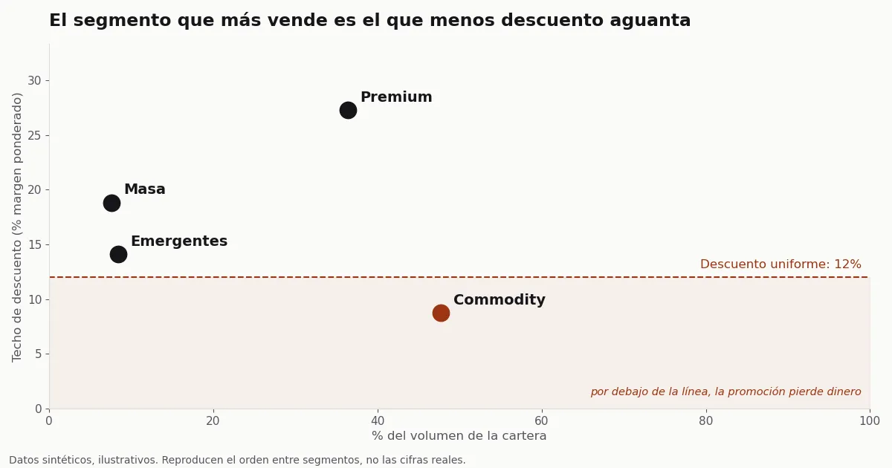

## El problema

En [Garza](https://garza.es/), la marca propia de iluminación, conectividad e IoT de
[Imprex](https://imprex.es/), todos los clientes B2B recibían la misma
promoción comercial. Nadie sabía cuánto margen costaba cada punto de descuento,
ni en qué clientes ese margen no sobraba. Lo que decía la intuición de
cualquier comercial era que los clientes grandes, como compran más, aguantan
más descuento.

La pregunta era práctica: a quién se le puede descontar, cuánto y a cambio de
qué.

## Qué hice

Primero agrupé a los clientes por cómo compran: cuánto, con qué frecuencia,
de cuántas categorías, si crecen o caen y qué margen deja cada uno. Salieron
cuatro grupos, y cada uno pide una oferta distinta:

- **Premium**: grandes, frecuentes y con margen alto. Hay que proteger el margen.
- **Commodity**: el grupo que más volumen suma, con margen estrecho y unos pocos clientes muy grandes. Hay que empujar volumen sin regalar precio.
- **Emergentes**: pocos clientes, creciendo deprisa.
- **Masa**: muchos clientes pequeños.

Por qué cuatro y no otro número lo cuento más abajo.

Después calculé el techo de descuento de cada grupo, que es el margen que
deja, pesado por lo que compra cada cliente. Una promoción que pase de ese
porcentaje pierde dinero en ese grupo, la acepte quien la acepte.

Para que ventas pudiera usarlo, traduje los grupos a reglas de una frase,
del tipo "si compra más de X y deja más de Y de margen, es Premium". Un
comercial las aplica al teléfono, sin abrir ninguna herramienta.

Y cambié la forma de la oferta. En lugar de un descuento igual para todos,
un rappel: "si me compras un tanto más de lo que ya me compras, te descuento
solo sobre lo que crezcas". La referencia es lo que compraba cada cliente y no
la media de su grupo; con un umbral común, el que ya estaba por encima se lleva
el descuento sin crecer.

## Resultado



*Datos sintéticos, generados con el código del
[repositorio del caso](https://github.com/acamposla/promociones-b2b): conservan el orden entre
segmentos del caso real, no sus cifras.*

Commodity, el grupo que más volumen sumaba, era el que tenía el techo de
descuento más bajo. Con la misma promoción para todos, se perdía dinero justo
donde estaba la mayor parte del negocio, mientras en Premium, que aguantaba
bastante más, quedaba margen sin usar.

Entregué el análisis y un simulador en Power BI con tres deslizadores:
descuento, aceptación y crecimiento exigido. Al moverlos se ve el neto de la
promoción en cada grupo, cuánto queda hasta el techo y qué parte de los
clientes deja menos margen del que se le descuenta. El de Power BI lleva los
datos reales dentro, así que aquí va rehecho sobre los datos sintéticos:



Las promociones las decidía yo, y antes de salir de la empresa empecé a usar
el techo de cada grupo como referencia al diseñarlas. Lo fui metiendo poco a
poco, sin cambiar de golpe la política comercial.

El efecto no lo pude medir. La factura dice quién compró y con qué descuento,
pero no a quién se le ofreció la promoción y no compró, ni si el descuento
venía de un rappel o de un precio rebajado. En distribución es lo habitual, y
por eso el techo es lo primero que entrego: sale de la facturación y no
depende de cuántos clientes acepten.

El siguiente paso era un piloto con grupo de control. Consiste en apuntar,
antes de lanzar, a quién se le ofrece la promoción, y dejar fuera al azar una
parte de cada grupo. Así se mide cuánto crece de verdad quien acepta y cuánto
descuento se lleva quien habría comprado igual. No llegué a lanzarlo. Sirve
para la cartera de cualquier distribuidor B2B que facture por cliente.

## Qué decidí

La estadística pedía dos o tres grupos. Con dos, el cliente que deja buen
margen y el que deja poco caían juntos, y necesitan ofertas opuestas: al
primero hay que cuidarle el precio y al segundo pedirle volumen a cambio. Con
tres, los clientes de margen estrecho más grandes, que hacen la mayor parte del
volumen de su grupo, se juntaban con los de buen margen, y el resto se perdía
entre la masa de clientes pequeños.

Me quedé con cuatro sabiendo que los grupos salen menos nítidos de lo que
recomienda el método. En una cartera donde los clientes pasan de un perfil a
otro poco a poco, es lo que cabe esperar. A cinco tampoco fui: con cinco, el
método apartaba un grupo de pocas decenas de clientes, y diseñar una oferta
para tan pocos no compensaba.

El otro precio fue la precisión. Las reglas de una frase aciertan el grupo en
casi nueve de cada diez clientes y con el resto se equivocan. Lo preferí a
pedirle a ventas que consultara un modelo cada vez que llamara a un cliente.

## Qué me llevo

Antes de diseñar una promoción, calcula el techo de descuento de cada grupo de
clientes: si el que más compra tiene el techo más bajo, el descuento igual para
todos lo paga él.

[Descarga la presentación del caso en PDF](/assets/docs/caso-promociones-b2b.pdf) (siete
diapositivas, cifras sintéticas; también [en inglés](/assets/docs/b2b-promotions-case.pdf)).

<details markdown="1">
<summary>Cómo se hizo, para quien quiera el detalle técnico</summary>

- **Segmentación:** K-Means sobre seis variables por cliente (volumen,
  frecuencia, ticket medio, margen relativo, número de categorías y tendencia
  frente al año anterior), con transformación logarítmica de las variables de
  escala y RobustScaler. Probé de 2 a 10 grupos. La silueta favorecía dos y
  Calinski-Harabász tres, sin un codo claro en la inercia. Elegí k=4 por
  criterio comercial.
- **Reglas:** árbol de decisión de profundidad 3 entrenado sobre las etiquetas
  de K-Means. Reproduce el grupo en el 87 % de los clientes del caso real (en
  los datos sintéticos del repositorio, el 93 %). Es una medida
  descriptiva y no valida el clustering, porque el árbol aprende de las mismas
  variables que formaron los grupos.
- **Rentabilidad del rappel**, para un grupo:

  ```
  neto = r · u · V · (m − d)
  ```

  V es el volumen del grupo, r la parte de clientes que acepta, u el
  crecimiento que se pide, d el descuento y m el margen ponderado. Si d = m, el
  neto es cero sea cual sea r: la tasa de respuesta decide cuánto se gana, y el
  descuento decide si se gana. Por eso el techo se calcula sin datos de
  campañas.
- **Herramientas:** SQL y Python para el análisis, Power BI para el simulador.
- **Código:** [acamposla/promociones-b2b](https://github.com/acamposla/promociones-b2b), con
  un generador de facturas sintéticas, la tabla de clientes en SQL, el notebook del caso
  ejecutado, el simulador y dieciséis tests. Se instala y se ejecuta en unos minutos.

</details>
