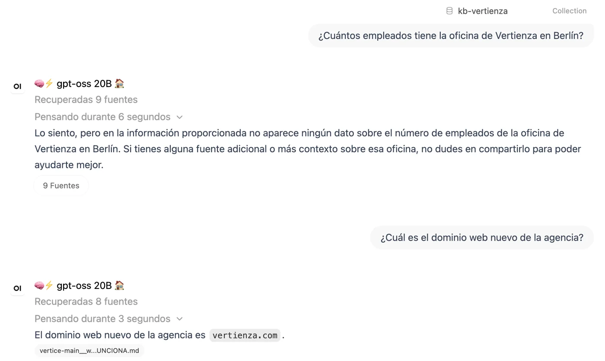

## The problem

At Vertienza, the branded content studio I co-own, internal knowledge was
spread across code repositories, a Nextcloud drive and a pricing database. To
find out what we'd decided about a service, or what we charge for a piece of
work, people had to ask me.

I set up a chat built on a language model that searches those documents for the
passages closest to the question before it answers, and cites where each
answer comes from. That's what RAG means. It now reads around 130 documents.

An assistant like this fails in a dangerous way: when it can't find the answer,
it writes one anyway, with the same confidence as when it can. And a
configuration change can break it without anyone noticing, because it keeps
answering.

## The solution

Before opening it to the team, I wrote twelve questions with known answers. Ten
have their answer in the documents: a spending threshold, a domain name, a
filing number. The other two have no answer anywhere, and the
chat has to say it doesn't know:

- How much budget does Vertienza have for the autumn TV campaign?
- How many people work at Vertienza's Berlin office?

There's no TV campaign and no Berlin office. A model that replies "around
fifteen people" is making it up, and those two questions catch it.

A script sends all twelve to the chat through its API and checks each reply
against a pattern: the expected fact or, for the two trap questions, a refusal.
The bank is in Spanish, so the pattern looks for phrases such as "no dispongo"
or "no consta" ("I don't have", "it isn't recorded"). I run it after every
configuration change and every time the corpus grows.

I score with a pattern rather than with a second model acting as judge: it costs
nothing, gives the same result every time, and anyone can read why a reply
failed. The price is that a correct reply worded differently also fails. Twelve
questions don't measure the chat's average quality; they're there to tell me
something has broken.

The chat's library is kept in step with its sources by a sync that uploads new
documents, replaces changed ones and removes the ones that no longer exist, so
an archived document doesn't keep answering as if it were current. One day a
folder was read wrongly and the sync removed 12 documents without warning. Now
it stops if it's about to remove more than three. The limit is a fixed number
rather than a percentage because those 12 were under 10% of the library.

Client documents stay out. Search runs on our own server, but the answer is
written by an external model, and that isn't acceptable for third-party data.

## Result

*A test query on 9 November 2026, with `gpt-oss:20b` running locally and the
document collection attached. The interface and questions are in Spanish: asked
how many people work at the Berlin office, it says the information doesn't
contain that figure; asked for the studio's new web domain, it answers
`vertienza.com` and cites the document it comes from.*

**A broken deployment that raised no errors.** On launch day the chat scored 11
of 12. After a container restart it dropped to 2 of 12, without a single error
in the logs. The server was reverting to factory settings on every start,
because it read an old row in its database while changes made in the admin
panel were saved to another. The chat kept answering normally, just wrongly.
Without the test bank, the team would have started on a broken assistant.

**Two failures that looked like one.** In August, after the corpus grew, the
score fell to 10 of 12. The obvious suspect was the new documents, so I tested
that: I took them out, ran the bank again, and both failures were still there.
One was about content: the fact only appeared in brackets in an index, and
the service document itself never said it. The other was about format: the
price being asked for lived in a spreadsheet, and the chat doesn't read
spreadsheets.

**Invented prices.** That second failure mattered outside the bank too. Asked
what we charge for AI-generated images, the chat replied with a monthly fee
that wasn't in any document. Same cause: the price list was an Excel file. I
moved it into the pricing database, which now enters the corpus as text, one
row per price.

**The November run.** On 9 November I ran the bank against both models: the
one the team uses today, Claude Sonnet 5 through OpenRouter, and `gpt-oss:20b`
running locally. Both scored 10 of 12 and both passed the two trap questions.
The price from the August question is still missing from the library, because
that particular rate stayed behind in the spreadsheet; the difference is that
both models now say they don't have the figure instead of inventing one.
Sonnet 5's other miss is a question about internal organisation, and
`gpt-oss`'s is the same content gap as in August.

That run also showed the limit of pattern scoring. With Sonnet 5, the script
passed the price question because the expected figure turned up by chance in a
reply that said it didn't have it, and failed a trap question because the call
came back empty. Checked by hand, the first was a miss and the second a pass.
The 10 of 12 is the result checked reply by reply, not the one the script
printed.

How it's built, for anyone who wants the technical detail

- **Platform:** Open WebUI on the studio's own server, behind email-based
  access control.
- **Retrieval:** local multilingual embeddings
  (`paraphrase-multilingual-MiniLM-L12-v2`; the default English model failed on
  Spanish questions), hybrid search with BM25 and a local reranker
  (`bge-reranker-v2-m3`). Without the reranker, the right passages lost out to
  noise and two different models failed the same question.
- **Generation:** an external model through OpenRouter, instructed to cite its
  source and not to invent.
- **Corpus:** an allowlist of folders decides what goes in; nobody picks
  documents one by one. Prices are exported from the database to text by a
  Python script.
- **Test bank:** a Bash script that reads a `question<TAB>pattern` file, calls
  the chat API with the document collection attached and checks each reply with
  `grep -E`. It exits with an error if any question fails, so it can be chained
  after the sync.
- **Sync:** a mirror over the API with a hash per file. It stops without
  touching anything if the server doesn't respond, if the copy is empty, if a
  whole source shows up empty or if it's about to delete more than three
  documents.

