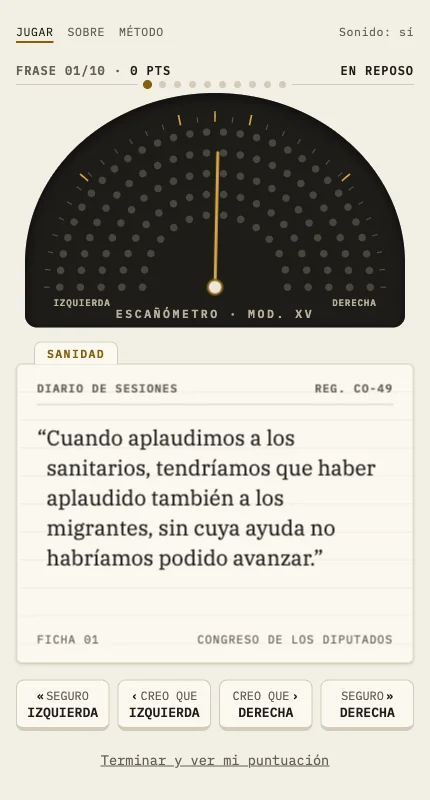
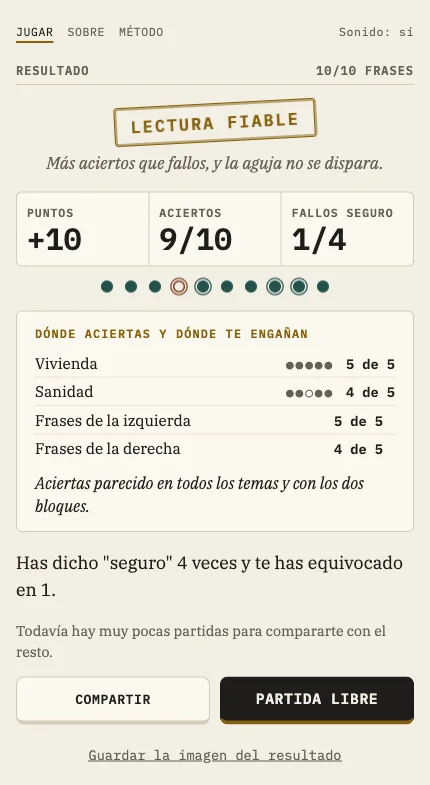

## The problem

We think the two political blocs are further apart than they are. Social psychology calls it false
polarisation, and one of its causes is published: we generalise about "what the left says" or
"what the right says" from evidence that doesn't support it ([Novoa et al., 2023,
PNAS](https://doi.org/10.1073/pnas.2309361120)). I wanted to test it against what is actually said
in the Spanish parliament: how many quotes someone who follows politics would place wrongly, and
above all how many they'd place wrongly while feeling sure.

A tool like this only works if nobody can accuse it of picking quotes to suit one side. On a
political subject, the defence can't be the good faith of whoever built it. It has to be
checkable.

## The solution

**A ten-quote game.** A quote from the parliamentary record appears and you bet with four buttons:
"sure left", "I think left", "I think right" or "sure right". When you answer, the card shows who
said it, their group, the date and a link to the official PDF of the session. At first confidence
was a separate question; in my first test I answered "sure" to all twenty quotes and the extra
question slowed the game down, so it moved into the buttons.

**No quote is picked by a person.** The catalogue comes from 76,421 speeches in the current
legislature (824 sessions), through filters written in code:
- length, topic by keyword list and Spanish only, because a translation stops being a quote;
- out goes anything that gives the speaker away without an argument (party names, "our group",
  "minister") and anything quoting someone else, because an MP quoting a rival would produce a
  false attribution with correct data;
- four groups (PP and Vox, PSOE and Sumar) and no others, because if the right answer is debatable
  the tool measures nothing.

Playing it, I found quotes that gave themselves away: names of politicians, regional party
acronyms, Catalan political terms. None was removed by hand. Each pattern became a general rule
with its own test, and one filter that hit one bloc harder than the other was dropped.

**A language model, measured before use.** An open model, run locally, decides whether each quote
is really about the topic and whether it makes a claim you could argue for or against. It never
sees the party or the speaker. To choose it, I blind-reviewed 50 quotes myself, seeing only the
topic and the text, and compared three models with my review. The first round showed that my
definition of "stance" was ambiguous: I rewrote it and repeated that part. The model I chose agrees
with me on 90% of quotes about whether they're on topic and 86% about whether they take a stance.
It's poor at spotting filler; I accepted that as a risk and the methodology says so.

**Every quote checked against the official PDF.** 238 of the 240 by two methods, text and speaker,
and the other two by one.

**The method, published before any result was analysed.** The
[methodology](https://escanometro.com/metodologia.html) is on the site. The rule for retiring a
quote as too easy (15 answers and 85% correct) was set on 4 October, before the first answer.

**Privacy by design.** No cookies, nothing stored on the device and no question about the player's
own views, only their attribution. That way the answers aren't data about anyone's politics.

## Result

The game has been live since 5 October 2026, with 240 quotes (40 per topic and bloc, on pensions,
health and housing) and the methodology published.

*A test game, not anyone's result.*

The goal was for it to spread, and I never got round to promoting it. The first forum on the plan
required new accounts to build up some activity first, which I didn't do, and I didn't push it
through other channels. With the games played so far, I can't give the share of misattributed
quotes without the figure claiming more than it knows, so I don't.

How it's built, for anyone who wants the technical detail

- **Data:** I start from the open parse of the parliamentary record by the escano-abierto project
  (MIT licence), from 17 August 2023 to 23 September 2026. The pipeline is in Python, standard
  library only.
- **Selection:** 3,724 candidate quotes after the filters, 3,227 after the model, 1,478 approved by
  both quality judges and 240 in the catalogue, by random sampling with a fixed seed and the same
  number of quotes per topic and bloc.
- **Quality:** two independent models (Claude Sonnet and DeepSeek) judge each quote, and the
  benchmark for how many faulty ones slip through is a blind reading by a third model.
- **Web:** Cloudflare Pages and a D1 database for the answers, with no server of its own.
- **Code:** MIT licence, at [acamposla/escanometro](https://github.com/acamposla/escanometro), with
  60 tests and the method explained step by step in the README. Code and docs are in Spanish.

