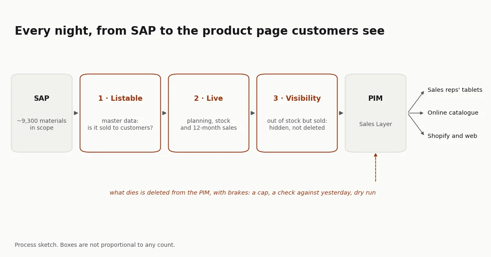

## The problem

Imprex distributes third-party brands and has its own, Garza among them, and
sells through several channels: the sales reps' tablets, the online catalogue
and Shopify, among others. All of them draw on a PIM, Sales Layer, which in
turn should draw on SAP.

In practice, deciding which products appeared in each catalogue was manual and
depended on who did it. There was no rule saying "this product has the stock to
be listed" or "this one is discontinued, take it out". Each brand manager
applied their own judgement. You could see the result from outside:
out-of-stock products still in the catalogue, new products taking weeks to
appear, and thousands of pages in the PIM for products SAP had already retired.

Sales, who sold from that catalogue, and marketing, who maintained it, felt it
most.

The technical problem was the small one. The hard part was that the rules
weren't written down anywhere: what counts as a sellable product, what to do
with one that's out of stock but sold two months ago, what happens when the
same barcode has three SAP codes.

## The solution

**First, write the rules down.** Before a line of code, I wrote down what makes
a product listable: it belongs to a sector we sell, it's an item type that's
sold to customers, it has a barcode, and it isn't a loose part of a display
unit. Some of those rules I had to confirm with IT field by field, because the
name of an SAP field doesn't always mean what it seems to.

**Then, a layered funnel that runs by itself.** Of the roughly 9,300 SAP
materials in scope, the process decides every night:

1. **Listable:** whether the product is relevant to any catalogue, from master
   data only. Everything that isn't sold to customers drops out here: services,
   billing items, material without a barcode.
2. **Live:** whether it's available to sell, from actual planning, stock and
   the last twelve months of sales.
3. **Visible or hidden:** a product that runs out of stock but has sold in the
   last year isn't deleted, it's hidden. That keeps the work marketing has put
   into its page (photos, copy, attributes), and it reappears when it's
   restocked.
4. **Publishing:** live products go to the PIM every night. What dies is
   deleted from the PIM by comparing what's there with the list of live
   products.

Two design decisions that matter beyond the code. The calculation runs per
barcode, not per SAP code, because one product can have several substitute SAP
codes and to the customer it's a single product. And deletion has brakes: it
won't act if the list to delete exceeds a cap or changes too much against the
previous day, and by default it only simulates. An error upstream can't empty
the catalogue overnight.

**Finally, set out who decides what.** Automation removes repetitive work, but
it doesn't remove decisions. I wrote a governance document stating what each
team does and doesn't do: IT maintains the SAP replicas and the server;
logistics, the master data coming in; each brand manager, the enrichment of
their pages and which channel each product goes to; and I, as PIM owner, the
rules and the process. Without that split, incidents land with the wrong team
and critical tasks fall to nobody.

The test came with the first complaints. Brand managers sent me a batch of
products the process was about to remove and that, in their view, had to stay.
I went through them one by one and only a couple were process errors. The rest
were products flagged for deletion in SAP that the brand wanted to keep,
products with no stock and no replenishment, one or two without a barcode, and
a handful that were already in the catalogue. What I proposed to management
wasn't a code change but a change to the workflow: a decision tree so each
brand manager could see why a product isn't showing and who to go to, and a
report per brand explaining each product's status in plain language.

The hardest part was the teams handling third-party brands. Many manufacturers
have their own PIM, and those teams looked up the product page there instead of
enriching it in ours. That made sense: the information already existed. But the
manufacturer's PIM doesn't know what stock we have, what price we sell at or
which channel each product goes to, and a distributor sells from its own
catalogue, not the manufacturer's. With some brands it was fully resolved and
their pages moved to being enriched in our PIM; with Garza, the brand I ran,
too. With others it never got there.

## Result

In April 2026 the process moved from my laptop to a company server and started
running by itself every night: SAP dumps its tables, the process recalculates
each product's status and publishes to the PIM, and a later step deletes what
has died. Manual decisions about which products appear were gone for the whole
sellable catalogue. When I left the company at the end of April, it was still
running every night without anyone touching it.

The PIM became the source for the channels: the sales reps' tablets, the online
catalogue and [garza.es](https://garza.es/), Garza's Shopify website, which I
set up to draw directly from the PIM. A page enriched once reaches all of them.

Printed catalogues stopped being put together by hand. With the EasyCatalog
plugin, InDesign reads straight from the PIM, and I taught the designers to
connect and to use markers and filters that apply the same business rules:
those in the process that loads the PIM and those that live in the PIM itself.
With that, a designer can produce the catalogue for a brand or a customer
without asking anyone for the data.

What remained was deciding which product goes to which channel. One rule was
already in production: some channels only want products with stock cover, so a
product that isn't being replenished only goes in if it has at least three
months of stock at last year's sales rate. Exclusivity by customer or by type
of store I left specified as a cascade (first the product's rule, otherwise the
brand's, otherwise the company's), with the rules in a table managed by the
business so a new channel doesn't require touching code. When I left, it was
waiting on the commercial decision about exclusivity.

Along the way, the manual process's blind spots came out: hundreds of
materials without a barcode that inflated the count of listable products
without ever reaching a catalogue, display-unit parts that aren't sold
separately, and thousands of PIM pages for products that no longer existed.

The technical side was the easy part. What took most effort was writing down
business rules that until then lived in people's heads, and getting each
department to accept its share.

This experience is the basis of the catalogue service I now offer at
[Sapioverse](https://sapioverse.es/es/casos/catalogo-imprex/) (in Spanish).

How it's built, for anyone who wants the technical detail

- **Source:** SAP S/4HANA, replicated into Oracle every afternoon by IT.
- **Layer 1, listable:** a materialised view in Oracle with the master-data
  filters (sector, item type, category, barcode, display part and plant). A
  wall inside the query stops a non-listable product from reaching layer 2.
- **Layer 2, live:** a Python ETL that joins planning, stock and twelve months
  of sales per barcode, with substitute tables. Adapted to the S/4HANA
  migration, which moved stock movements to a different table.
- **Publishing:** a daily export to the PIM over FTP, and deletion through the
  API by comparing the PIM with the list of live products, with a cap, a check
  against the previous day and dry run by default.
- **Orchestration:** a daily script with dependency ordering (calculation, view
  refresh, export) on a company Linux server, with cron.
- **Tests:** unit tests for the stock-cover calculation.
- **Code:** the original belongs to Imprex and isn't published. The rules are
  rewritten on a synthetic catalogue in
  [acamposla/catalogo-vivo](https://github.com/acamposla/catalogo-vivo), with
  layer 1 in SQL, layer 2, the guarded reconciliation and 29 tests. Code and
  docs are in Spanish, with an English summary.
- **Still pending when I left:** the initial mass clean-up of the PIM, waiting
  on marketing's sign-off, and a third layer of per-channel catalogues, which
  needed a business decision on exclusivity.

