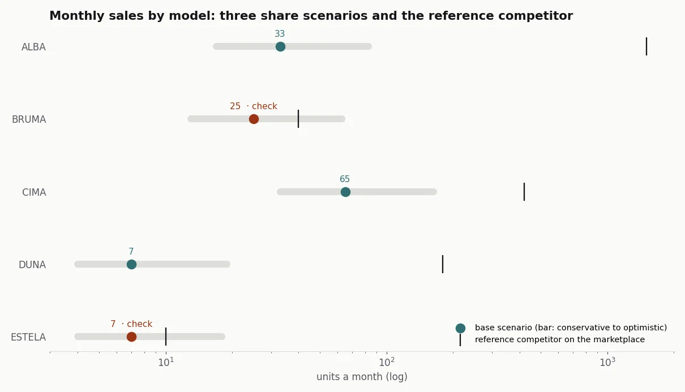
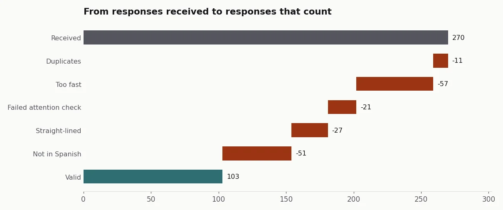
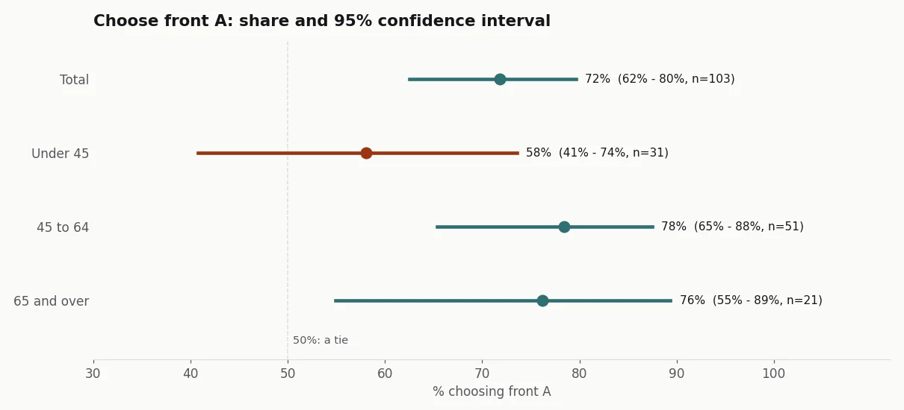

## The problem

In 2026 Garza was preparing a new range of Wi-Fi security cameras, each model aimed at a different
kind of buyer. Before launch, two questions had to be answered that don't allow for "we'll see":
how many units of each model to order from the supplier, with the months of safety stock set by
purchasing, and which pack front works better on the shelf.

There were no sales of our own for those models, because they didn't exist yet. What there was:
market data that isn't yours (a retail panel of in-store sales and the best sellers on a
marketplace) and the option of asking consumers.

## The solution

**Demand, per segment and top-down.** For each model:

1. From the retail panel, sales of the same camera type in the same price band, refined by
   resolution and power supply where the panel allows it.
2. Since the panel doesn't cover every store, offline sales are scaled up by a coverage factor.
   It's the weakest assumption, so it sits in plain sight as a parameter rather than hidden in a
   formula.
3. From the marketplace, the same category and price band. There are no technical attributes there,
   so it can't be refined any further.
4. Three share scenarios on the segment's market (conservative, base and optimistic), instead of a
   single number that hides the uncertainty. Two of our models in the same segment split the
   share; otherwise the brand counts the same market twice.
5. The order: the scenario's monthly sales times the months of safety stock.
6. A check: base-scenario sales against the reference competitor's on the marketplace. If a model
   needs to sell more than half of what that competitor sells, it gets reviewed by hand.

**The consumer, with a survey that had to be cleaned before counting.** The survey included an
A/B test of two pack fronts. The online panel was cheap and brought a lot of junk: bots answering
in seconds, answers in other languages, people giving the same answer to everything. More than
half of the responses were unusable. Cleaning has to come before any percentage, and each
discarded response keeps its reason so the cleaning can be audited.

I also started from buyer personas treated as hypotheses, since they came from secondary sources
rather than our own measurement, and crossed persona by camera type to prioritise which models to
develop first.

## Result

The real figures stay at Imprex, and the market data is licensed. I rebuilt the study on synthetic
data with the same shape: a panel, a marketplace, five invented models and 270 survey responses
with their junk.

*Synthetic data, generated with the [case code](https://github.com/acamposla/lanzamiento-camaras).*

The check flags two models. In both, the reference competitor sells very little for the size of its
segment: either it's a niche nobody has taken yet, or the chosen competitor isn't the one that
leads. In neither case is market share a good guide, and the order is decided by judgement,
not by the formula.

With the valid responses, front A clearly wins overall. By age, the interval says what the
percentage alone doesn't: among under-45s, with 31 responses, the interval drops below 50% and you
can't claim it wins. With a sample that size, the packaging decision rests on the groups where the
result is clear, and the rest is stated as such.

In the real study I delivered the market analysis, the order estimate per model, the range
prioritisation, the survey report and the presentation for the sales team. Repeating the survey
with a better-quality panel, filtered by language and country at source, was left pending.

How it's built, for anyone who wants the technical detail

- **Price bands:** fixed cut-offs (<25, 25-35, 35-50, 50-75, 75-100, 100+ €), the same for the
  panel and the marketplace, so both segments are comparable.
- **Share scenarios:** 1%, 2% and 5% of the segment's market, split evenly among our models that
  share it.
- **Check:** a model is flagged when its base scenario exceeds half of the reference
  competitor's sales.
- **Survey cleaning:** five rules in order (duplicate device fingerprint, under a third of the
  median duration, failed attention check, straight-lined grid and free text in another language);
  a discarded response keeps the first reason.
- **A/B test:** Wilson 95% confidence interval, overall and by age.
- **Code:** [acamposla/lanzamiento-camaras](https://github.com/acamposla/lanzamiento-camaras),
  with 21 tests and charts that export in Spanish or English. Code and docs are in Spanish, with
  an English summary.

