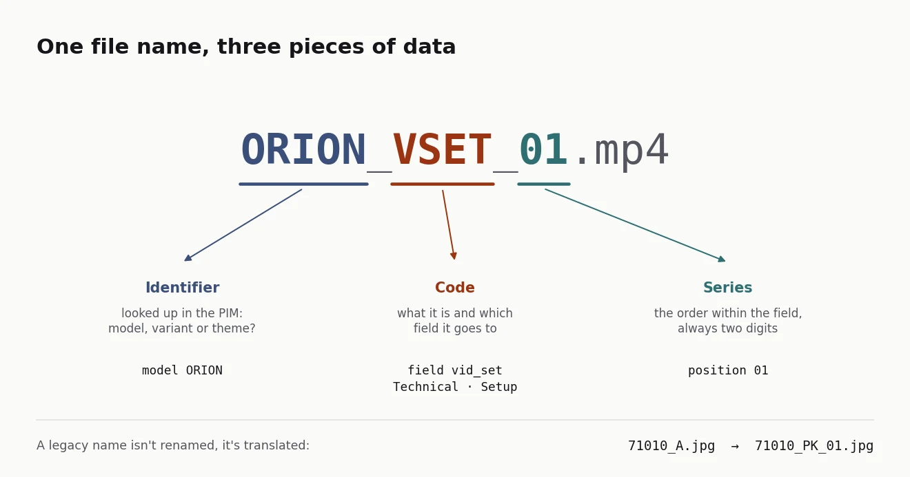
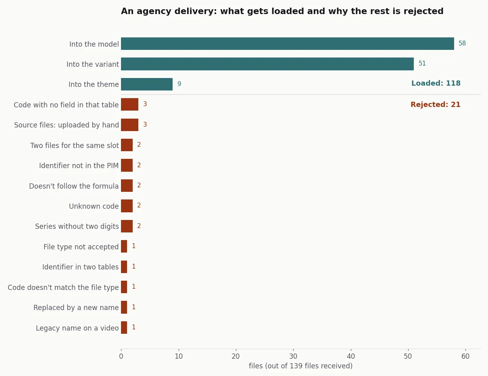

## The problem

Garza's product photos and videos were made by designers and agencies, and their home was the PIM,
where every record already had image fields. It's the same PIM that was fed from SAP every night
([I tell that story here](/en/portfolio/from-9300-sap-materials-to-one-product-page/)). But putting
each file in its record and its field was manual work. A digital asset management tool (a DAM)
solves that, at the cost of another licence and another system to keep in step with the catalogue.

On top of that, the archive came with names from another era (`_A` for the packshot, `_5` for the
lifestyle shot) that nobody was going to rename.

## The solution

**The file name as data.** Every file follows the formula `IDENTIFIER_CODE_SERIES`:
`ORION_VSET_01.mp4` is the first setup video for the Orion model. Whoever produces the file only
has to name it properly. The name is enough to put the file in place, without anyone opening the
record.

- **Three tables in the PIM.** The model; the variant, which is each sellable reference (colour,
  pack size); and a new table of marketing themes, for things that have photos and videos without
  being a product, such as the solar range or Wi-Fi connectivity. Each table has a fixed field per
  code.
- **A closed dictionary of codes.**
  - Nine are for images: packshot, box, product with box, horizontal and vertical hero, lifestyle,
    detail, feature mosaic and its pieces.
  - Three are for video.
  - Each code carries a type and a context, used for filtering in the brand portal.
- **The archive is translated, not renamed.** `_A` reads as `_PK_01`, `_5` as `_LF_01` and `_4`
  as `_FT_01`. Every new file follows the formula.
- **Source files go separately.** PSD, AI and PDF files are working material. They have their own
  tab and are uploaded by hand.

**Three videos, one per moment in the buyer's journey.** I started with five types and cut them to
three. Installation, connection and configuration were three separate videos, when the buyer has a
single question: how do I get this working?

- **VMK**, to make the purchase decision: the product in use and what it solves.
- **VSET**, from opening the box to a working product. It's modular:
  - a solar wall light only needs installation;
  - a smart bulb needs connection and configuration;
  - an IP camera needs all three.

  In configuration, the essentials come first (without them the product doesn't work), then the
  advanced settings.
- **VTR**, for when something goes wrong: the symptom, the likely cause and the fix.

I wrote a template script for each one, so an agency could produce them in batches. Videos belong
to the model, not the variant, because the setup video works for every colour.

## Result

These were done:

- the naming convention;
- the fields in the PIM;
- the video protocol with its scripts;
- the name parser, with 26 tests.

The formula was used in-house. Each file landed in its PIM field on its own, and the InDesign
catalogues pulled it from there through the connector, with nobody hunting for the photo by hand.

I've rewritten the method on an invented catalogue of eight models, their variants and five themes.
I ran a synthetic agency delivery through it, with the usual mistakes: one-digit series, made-up
codes, source files mixed in and the same file exported twice.

*Synthetic data, generated with the [case code](https://github.com/acamposla/dam-por-nombre).*

Of 139 files, 118 are loaded. The other 21 go back to whoever sent them, each with its reason. In
the rewrite I changed two things from the original:

- **Where the identifier lives.** The original decided whether an identifier was a product or a
  theme by its shape: letters only meant a theme. I had noted myself that this can't tell a model
  from a campaign with the same name. Now the catalogue is checked. If an identifier is in two
  tables, it's rejected rather than guessed.
- **What the variant doesn't take.** A lifestyle shot or a video named with a variant's reference
  goes up to that variant's model, rather than being left out.

How it's built, for anyone who wants the technical detail

- **Formula and codes:** the code dictionary, the fields per table and the legacy translation live
  in a single configuration file. Adding a code doesn't touch the logic.
- **Reading:** each name comes out as an asset (identifier, code, series, image or video) or as a
  rejection with its reason. There are seven reasons a name can be rejected when it's read:
  - doesn't follow the formula;
  - unknown code;
  - series without two digits;
  - video code on an image or the other way round;
  - legacy name on a video;
  - file type not accepted;
  - source file.
- **Clashes:** if two files go to the same record, field and series and one of them is legacy, the
  new one wins. If both are new, both are rejected, because choosing between two photos is up to
  whoever made them.
- **Upload:** the function that talks to the PIM takes the plan and uploads in series order. By
  default it's a dry run.
- **Code:** [acamposla/dam-por-nombre](https://github.com/acamposla/dam-por-nombre), with 51 tests
  and charts that export in Spanish or English. Code and docs are in Spanish, with an English
  summary.

