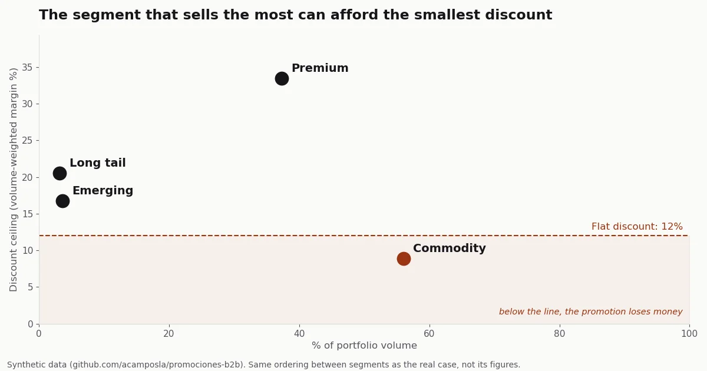

## The problem

At [Garza](https://garza.es/), [Imprex](https://imprex.es/)'s own lighting,
connectivity and IoT brand, every B2B customer got the same trade promotion.
Nobody knew how much margin each point of discount cost, or which customers
had no margin to spare. The gut feeling of any salesperson was that big
customers buy more, so they can take a bigger discount.

The question was practical: who can get a discount, how much, and in exchange
for what.

## What I did

First I grouped customers by how they buy: how much, how often, across how many
categories, whether they're growing or shrinking, and what margin each one
leaves. Four segments came out, and each needs a different offer:

- **Premium**: large, frequent and high margin. The margin needs protecting.
- **Commodity**: the segment with the most volume, thin margin and a few very large accounts. It needs volume without giving price away.
- **Emerging**: few customers, growing fast.
- **Long tail**: many small customers.

Why four and not another number is further down.

Then I worked out each segment's discount ceiling: the margin it leaves,
weighted by how much each customer buys. A promotion above that percentage
loses money in that segment, whoever takes it up.

So that sales could use it, I turned the segments into one-line rules, along
the lines of "if they buy more than X and leave more than Y in margin, they're
Premium". A salesperson applies them on the phone without opening any tool.

And I changed the shape of the offer. Instead of the same discount for
everyone, a rebate: "buy a set amount more than you already buy from me and
I'll discount only what you grow". The baseline is each customer's own past
purchases, not their segment's average; with a shared threshold, whoever was
already above it pockets the discount without growing.

## Result



*Synthetic data, generated with the code in the
[case repository](https://github.com/acamposla/promociones-b2b): it keeps the
ordering between segments of the real case, not its figures.*

Commodity, the segment with the most volume, had the lowest discount ceiling.
With the same promotion for everyone, money was lost exactly where most of the
business was, while Premium, which could take a lot more, left margin unused.

I delivered the analysis and a Power BI simulator with three sliders: discount,
take-up and required growth. Moving them shows the net result of the promotion
in each segment, how far it sits from the ceiling and what share of customers
leave less margin than they're being discounted. The Power BI file has the real
data inside, so here it's rebuilt on the synthetic data:



I was the one who decided the promotions, and before leaving the company I
started using each segment's ceiling as a reference when designing them. I
brought it in gradually, without changing the commercial policy overnight.

I couldn't measure the effect. An invoice shows who bought and at what
discount, but not who was offered the promotion and didn't buy, or whether the
discount came from a rebate or a price cut. That's normal in distribution, and
it's why the ceiling is the first thing I deliver: it comes from sales data and
doesn't depend on how many customers take the offer up.

The next step was a pilot with a control group: recording, before launch, who
gets offered the promotion, and leaving a random share of each segment out.
That measures how much takers really grow and how much discount goes to
customers who'd have bought anyway. I didn't get to launch it. The method works
for the customer base of any B2B distributor that invoices by customer.

## What I decided

The statistics favoured two or three segments. With two, the customer who
leaves good margin and the one who leaves little ended up together, and they
need opposite offers: the first needs its price protected, the second needs to
give volume in return. With three, the largest thin-margin customers, who make
up most of their segment's volume, were grouped with the high-margin ones, and
the rest got lost among the many small customers.

I settled on four knowing the segments come out less cleanly separated than
the method recommends. In a customer base where customers shade gradually from
one profile into another, that's to be expected. I didn't go to five either:
with five, the method split off a segment of a few dozen customers, and
designing an offer for so few wasn't worth it.

The other trade-off was accuracy. The one-line rules place nearly nine in ten
customers in the right segment and get the rest wrong. I preferred that to
asking sales to query a model every time they called a customer.

## What I took away

Before designing a promotion, work out the discount ceiling of each customer
segment: if the one that buys the most has the lowest ceiling, it's the one
paying for the flat discount.

[Download the case presentation as a PDF](/assets/docs/b2b-promotions-case.pdf)
(seven slides, synthetic figures).

<details markdown="1">
<summary>How it was done, for anyone who wants the technical detail</summary>

- **Segmentation:** K-Means on six variables per customer (volume, order
  frequency, average ticket, relative margin, number of categories and trend
  against the previous year), with a log transform on the scale variables and
  RobustScaler. I tried 2 to 10 segments. The silhouette score favoured two and
  Calinski-Harabász three, with no clear elbow in the inertia. I chose k=4 on
  commercial grounds.
- **Rules:** a depth-3 decision tree trained on the K-Means labels. It
  reproduces the segment for 87% of customers in the real case (93% on the
  repository's synthetic data). It's a descriptive measure and doesn't validate
  the clustering, because the tree learns from the same variables that formed
  the segments.
- **Rebate profitability**, for one segment:

  ```
  net = r · u · V · (m − d)
  ```

  V is the segment's volume, r the share of customers who take it up, u the
  required growth, d the discount and m the weighted margin. If d = m, the net
  is zero whatever r is: the response rate decides how much you make, and the
  discount decides whether you make anything. That's why the ceiling needs no
  campaign data.
- **Tools:** SQL and Python for the analysis, Power BI for the simulator.
- **Code:** [acamposla/promociones-b2b](https://github.com/acamposla/promociones-b2b),
  with a synthetic invoice generator, the customer table in SQL, the executed
  case notebook, the simulator and sixteen tests. It installs and runs in a few
  minutes. The repository is in Spanish, with an English summary.

</details>
