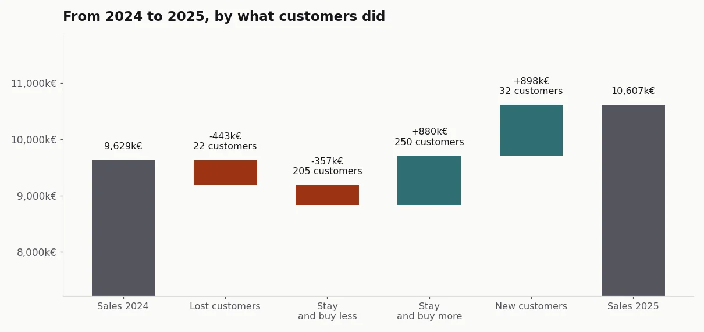
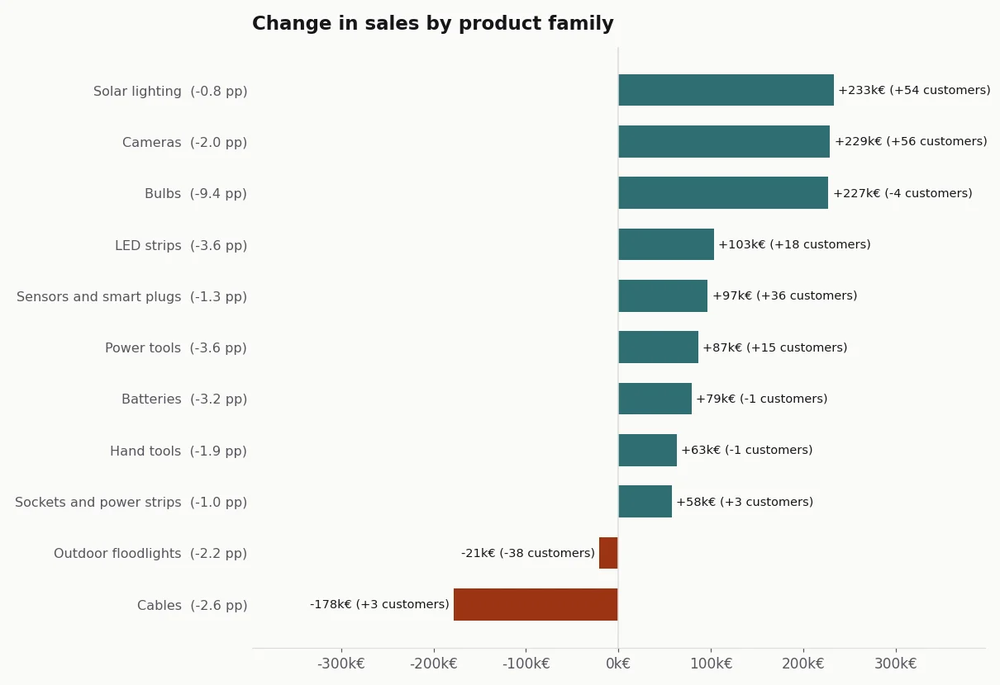
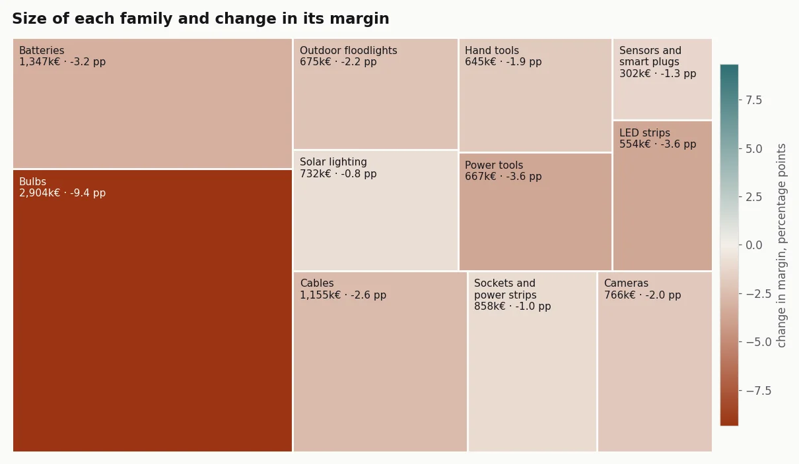
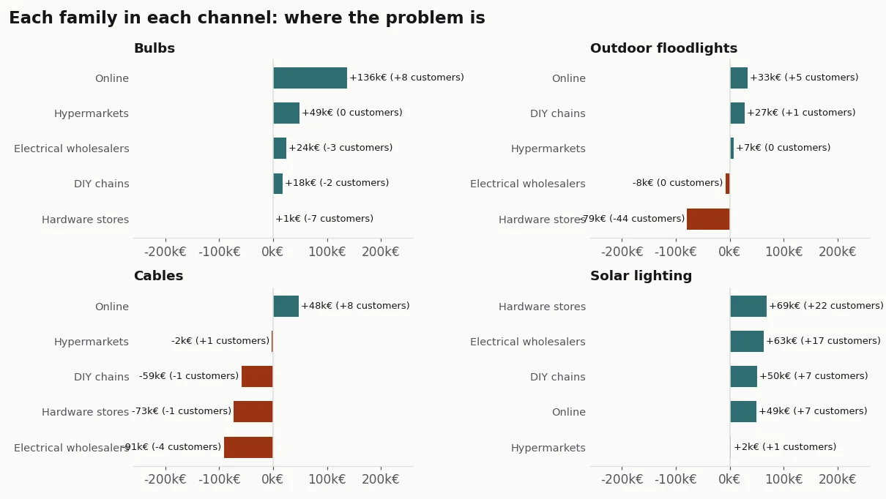

## The problem

In January 2026 I had to take Garza's year-end results to Imprex's CEO and leadership committee.
The question wasn't how much we'd sold. It was: **are we growing healthily? And if not, where is
the margin leaking: through price, customers or channel?**

A year-end report usually answers with tables, and in a table every drop looks the same. Losing
customers, customers buying less, and selling the same for less are three different problems with
three different fixes. If the report doesn't separate them, the committee argues about the
symptom.

## The solution

A Quarto report in R, built to be read in a meeting not consulted as a reference:

- **Story first, audit later.** Each section is a business question with a chart under it. Tables
  go to the end, in appendices, linked from a button under each chart. They never interrupt the
  reading.
- **Every change in sales comes with its change in customers.** A label reading "-50k€ (-12
  customers)" means customers are leaving; "-50k€ (0 customers)" means they're buying less. Next
  to each family's name, the change in margin in percentage points, which is where price shows.
- **One chart type per question.** A waterfall only to explain the year's net change; a treemap
  for each family's size and health without axes; a dumbbell for margin year on year; small
  multiples to see the same family in each channel.
- **Anything under €1,000 isn't plotted.** A residual family tells leadership nothing and takes
  space away from what matters. The appendix says how much was left out.
- **It prints in landscape without losing colour**, because some committees still read on paper.

## Result

The real figures stay at Imprex. What can be shown is the method, so I rebuilt it in Python on a
fictional distributor: different families, different channels and invented numbers, but the same
kind of stories a year-end report has to be able to find. The full report is in Spanish; the charts
here are in English.

*Synthetic data, generated with the [case code](https://github.com/acamposla/cierre-de-ano).*

At the synthetic distributor, sales rise 10% and margin in euros falls 3.5%: selling more, earning
less. The waterfall separates where the growth comes from (new customers and customers buying
more) and what works against it (customers who left and customers buying less).

With the composite label, three families that fall or stall tell three different stories. Outdoor
floodlights lose little money but 38 customers: customers are leaving. Cables lose €178,000
without losing customers: they're buying less. And bulbs grow in sales while losing more margin
than any other family, 9.4 points: that's price.

The treemap shows why total margin falls: the largest family is the one that lost the most margin.

And the channel panels locate each problem. The floodlight customers are being lost in one
channel, hardware stores. Lower spend on cables is spread across all the traditional channels.
Solar lighting grows in every channel, with new customers.

The full report, with the short answer, the effect of the online channel and the appendices, is
[here](/assets/docs/informe-cierre.html) (in Spanish). It's generated entirely from the
repository, and the tests check that every claim in the report holds in the data.

How it's built, for anyone who wants the technical detail

- **Original:** R with Quarto, `tidyverse`, `ggplot2` and `kableExtra`, on a file of sales and
  cost by customer and family for both years. HTML output with Bootstrap and print CSS.
- **Public version:** Python with Quarto and matplotlib, on the same kind of file, generated with a
  fixed seed.
- **Margin:** always on the group's totals (total margin over total sales), never as an average
  of percentages.
- **Customer bridge:** lost, new and, among those who stay, those buying more and those buying
  less. The four steps add up exactly to the total change, and a test checks it.
- **Treemap:** the squarified algorithm by Bruls, Huizing and van Wijk, implemented without
  libraries and with its own test.
- **Code:** [acamposla/cierre-de-ano](https://github.com/acamposla/cierre-de-ano), with fifteen
  tests and charts that export in Spanish or English. Code and docs are in Spanish, with an
  English summary.

