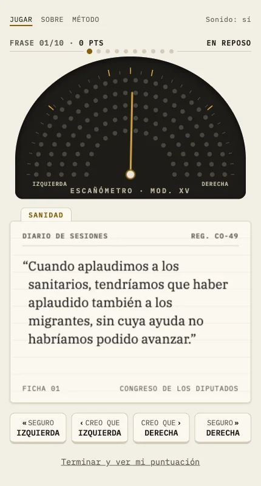
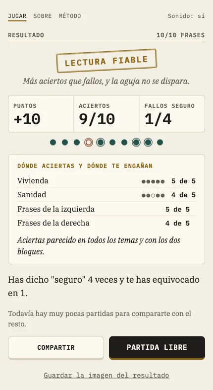

## El problema

Creemos que los dos bloques políticos están más lejos de lo que están. La psicología social lo
llama falsa polarización, y una de sus causas está publicada: generalizamos sobre "lo que dice la
izquierda" o "lo que dice la derecha" a partir de evidencia que no lo sostiene ([Novoa et al.,
2023, PNAS](https://doi.org/10.1073/pnas.2309361120)). Quería ponerlo a prueba con lo que de
verdad se dice en el Congreso: cuántas frases colocaría mal alguien que sigue la política, y sobre
todo cuántas colocaría mal estando seguro.

Un instrumento así solo vale si nadie puede acusarlo de elegir las frases a favor de un lado. Con
un tema político, la defensa no puede ser la buena fe de quien lo hace. Tiene que poder
comprobarse.

## La solución

**Un juego de diez frases.** Sale una frase del Diario de Sesiones y apuestas con cuatro botones:
"seguro izquierda", "creo que izquierda", "creo que derecha" o "seguro derecha". Al responder, la
ficha enseña quién la dijo, su grupo, la fecha y el enlace al PDF oficial de la sesión. Al
principio la confianza se preguntaba aparte; en mi primera prueba respondí "seguro" a las veinte
frases y la pregunta frenaba el juego, así que pasó a los botones.

**Ninguna frase la elige una persona.** El catálogo sale de 76.421 intervenciones de la XV
Legislatura (824 sesiones) por filtros escritos en código:
- longitud, tema por lista de palabras y solo castellano, porque una traducción deja de ser cita;
- fuera lo que delata al emisor sin razonar (siglas, "nuestro grupo", "señor ministro") y lo que
  cita a otro, porque un diputado citando a su rival daría una atribución falsa con datos
  correctos;
- cuatro grupos (PP y Vox, PSOE y Sumar) y ningún otro, porque si la respuesta correcta es
  discutible el instrumento no mide nada.

Jugando encontré frases que se resolvían solas: nombres de políticos, siglas regionales, términos
de la política catalana. Ninguna se quitó a mano. Cada patrón se convirtió en una regla general con
su prueba, y un filtro que afectaba más a un bloque que al otro se descartó.

**Un modelo de lenguaje medido antes de usarlo.** Un modelo abierto, ejecutado en local, decide si
cada frase trata de verdad del tema y si afirma algo que se pueda debatir. Nunca ve el partido ni
el orador. Para elegirlo revisé yo a ciegas 50 frases, viendo solo el tema y el texto, y comparé
tres modelos con mi revisión. La primera ronda enseñó que mi definición de "postura" era ambigua:
la reescribí y repetí esa parte. El elegido coincide conmigo en el 90 % de las frases sobre si
tratan del tema y en el 86 % sobre si afirman una postura. Detecta mal el relleno; lo acepté como
riesgo y la metodología lo dice.

**Cada frase, cotejada con el PDF oficial.** 238 de las 240 por dos métodos, el texto y el
orador, y las otras dos por uno.

**El método, publicado antes de analizar ningún resultado.** La
[metodología](https://escanometro.com/metodologia.html) está en la web. La regla para retirar una
frase por demasiado fácil (15 respuestas y un 85 % de aciertos) se fijó el 4 de octubre, antes de
la primera respuesta.

**Privacidad por diseño.** Sin cookies, sin guardar nada en el dispositivo y sin preguntar la
opinión de quien juega, solo su atribución. Así las respuestas no son datos de ideología.

## Resultado

El juego está en producción desde el 5 de octubre de 2026, con 240 frases (40 por tema y bloque,
en pensiones, sanidad y vivienda) y la metodología publicada.

*Partida de prueba, no el resultado de nadie.*

El objetivo era que circulara, y no llegué a difundirlo. El primer foro del plan pedía a las
cuentas nuevas una actividad previa que no hice, y no lo empujé por otros canales. Con las
partidas que hay no se puede dar el porcentaje de frases mal atribuidas sin que la cifra diga más
de lo que sabe, así que no lo doy.

Cómo está hecho, para quien quiera el detalle técnico

- **Datos:** parto del parseo abierto del Diario de Sesiones del proyecto escano-abierto (licencia
  MIT), del 17 de agosto de 2023 al 23 de septiembre de 2026. La canalización está en Python, solo
  con la biblioteca estándar.
- **Selección:** 3.724 frases candidatas tras los filtros, 3.227 tras el modelo, 1.478 aprobadas
  por los dos jueces de calidad y 240 en el catálogo, por muestreo aleatorio con semilla fija y el
  mismo número de frases por tema y bloque.
- **Calidad:** dos modelos independientes (Claude Sonnet y DeepSeek) juzgan cada frase, y la
  referencia que mide cuántas defectuosas se cuelan es una lectura a ciegas hecha por un tercer
  modelo.
- **Web:** Cloudflare Pages y una base de datos D1 para las respuestas, sin servidor propio.
- **Código:** con licencia MIT, en [acamposla/escanometro](https://github.com/acamposla/escanometro),
  con 60 pruebas y el método explicado paso a paso en el README.

