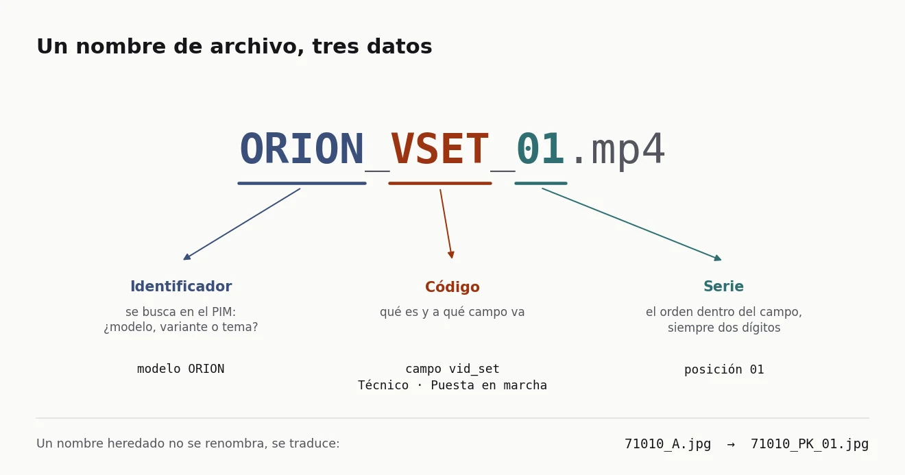
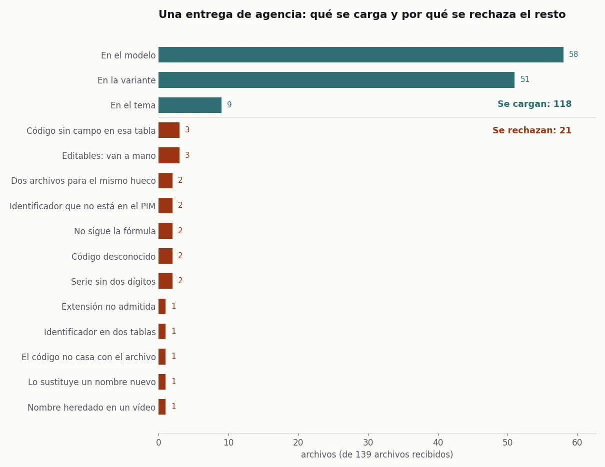

## El problema

Las fotos y los vídeos de producto de Garza los hacían diseñadores y agencias, y su sitio era el
PIM, donde cada ficha ya tenía campos de imagen. Es el mismo PIM que se alimentaba cada noche
desde SAP ([lo cuento aquí](/portfolio/de-9300-referencias-de-sap-a-una-ficha-de-producto/)). Pero
colocar cada archivo en su ficha y en su campo era trabajo manual. Una herramienta de gestión de
activos digitales (un DAM) lo resuelve, a cambio de otra licencia y de otro sistema que mantener al
día con el catálogo.

Además, el histórico venía con nombres de otra época (`_A` para el packshot, `_5` para la foto de
ambiente) que nadie iba a renombrar.

## La solución

**El nombre del archivo como dato.** Todo archivo sigue la fórmula `IDENTIFICADOR_CÓDIGO_SERIE`:
`ORION_VSET_01.mp4` es el primer vídeo de puesta en marcha del modelo Orion. Quien produce el
archivo solo tiene que nombrarlo bien. El nombre basta para colocar el archivo, sin que nadie abra
la ficha.

- **Tres tablas en el PIM.** El modelo; la variante, que es cada referencia de venta (color,
  formato); y una tabla nueva de temas de marketing, para lo que tiene fotos y vídeos sin ser un
  producto, como la gama solar o la conectividad wifi. Cada tabla tiene un campo fijo por código.
- **Un diccionario cerrado de códigos.**
  - Nueve son de imagen: packshot, caja, producto con caja, cabecera horizontal y vertical,
    ambiente, detalle, mosaico de características y sus piezas.
  - Tres son de vídeo.
  - Cada código lleva un tipo y un contexto, que sirven para filtrar en el portal de marca.
- **El histórico se traduce, no se renombra.** `_A` se lee como `_PK_01`, `_5` como `_LF_01` y
  `_4` como `_FT_01`. Todo archivo nuevo sigue la fórmula.
- **Los editables van aparte.** Los PSD, AI y PDF son material de trabajo. Tienen su pestaña y se
  suben a mano.

**Tres vídeos, uno por momento del comprador.** Empecé con cinco tipos y los dejé en tres.
Instalación, conexión y configuración eran tres vídeos distintos, cuando el comprador tiene una
sola pregunta: cómo pongo esto en marcha.

- **VMK**, para decidir la compra: el producto en uso y lo que resuelve.
- **VSET**, de abrir la caja a tener el producto funcionando. Es modular:
  - un aplique solar solo necesita la instalación;
  - una bombilla inteligente necesita la conexión y la configuración;
  - una cámara IP necesita las tres.

  En la configuración va primero lo esencial, sin lo que el producto no funciona, y después lo
  avanzado.
- **VTR**, para cuando algo falla: el síntoma, la causa probable y la solución.

Para cada uno escribí un guion tipo, para que una agencia pudiera producirlos por lotes. Los vídeos
van al modelo y no a la variante, porque el de puesta en marcha vale para todos los colores.

## Resultado

Quedaron hechos:

- la nomenclatura;
- los campos en el PIM;
- el protocolo de vídeo con sus guiones;
- el analizador de nombres, con 26 pruebas.

La fórmula se usó en interno. Cada archivo entraba solo en su campo del PIM, y los catálogos de
InDesign lo sacaban de ahí por el conector, sin que nadie buscara la foto a mano.

He reescrito el método sobre un catálogo inventado de ocho modelos, sus variantes y cinco temas. Le
he pasado una entrega de agencia sintética con los errores de siempre: series de un dígito, códigos
inventados, editables mezclados y el mismo archivo exportado dos veces.

*Datos sintéticos, generados con el [código del caso](https://github.com/acamposla/dam-por-nombre).*

De 139 archivos se cargan 118. Los otros 21 vuelven a quien los mandó, cada uno con su motivo. Al
reescribirlo cambié dos cosas del original:

- **Dónde vive el identificador.** El original decidía si un identificador era un producto o un
  tema por su forma: si eran solo letras, era un tema. Yo mismo dejé anotado que así no se distingue
  un modelo de una campaña que se llame igual. Ahora se consulta el catálogo. Si un identificador
  está en dos tablas, se rechaza en lugar de adivinarlo.
- **Lo que la variante no admite.** Una foto de ambiente o un vídeo nombrados con la referencia de
  una variante suben al modelo de esa variante, en lugar de quedarse fuera.

Cómo está hecho, para quien quiera el detalle técnico

- **Fórmula y códigos:** el diccionario de códigos, los campos por tabla y la traducción de
  heredados viven en un solo fichero de configuración. Añadir un código no toca la lógica.
- **Lectura:** cada nombre sale como activo (identificador, código, serie, imagen o vídeo) o como
  rechazo con su motivo. Hay siete motivos de lectura:
  - no sigue la fórmula;
  - código desconocido;
  - serie sin dos dígitos;
  - código de vídeo en una imagen o al revés;
  - nombre heredado en un vídeo;
  - extensión no admitida;
  - editable.
- **Choques:** si dos archivos van a la misma ficha, campo y serie y uno de ellos es heredado, gana
  el nuevo. Si los dos son nuevos, se rechazan los dos, porque elegir entre dos fotos le toca a quien
  las hizo.
- **Carga:** la función que habla con el PIM recibe el plan y sube los archivos en orden de serie.
  Por defecto simula.
- **Código:** [acamposla/dam-por-nombre](https://github.com/acamposla/dam-por-nombre), con 51
  comprobaciones y los gráficos exportables en español o en inglés.

