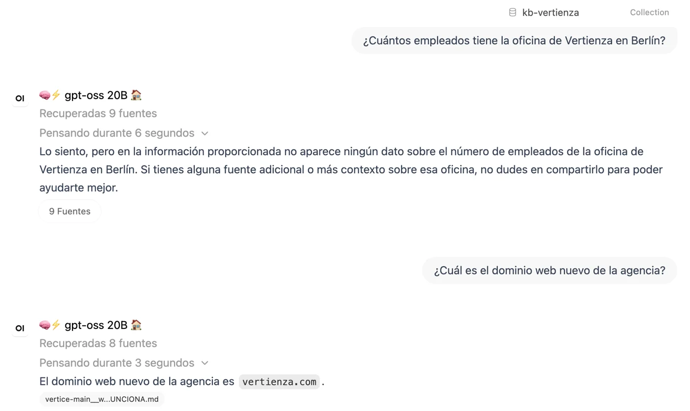

## El problema

En Vertienza, el estudio de branded content del que soy socio, la documentación
interna estaba repartida entre repositorios, Nextcloud y una base de datos de
tarifas. Para saber qué habíamos decidido sobre un servicio, o qué se cobra por
una pieza, había que preguntarme a mí.

Monté un chat con un modelo de lenguaje que, antes de contestar, busca en esos
documentos los fragmentos que más se parecen a la pregunta y responde citando
de dónde los saca. Es lo que se llama RAG. Hoy lee unos 130 documentos.

Un asistente así falla de una forma peligrosa: cuando no encuentra la
respuesta, la redacta igual, con la misma seguridad que cuando la encuentra. Y
un cambio de configuración puede romperlo sin que nadie lo note, porque sigue
contestando.

## La solución

Antes de abrírselo al equipo escribí doce preguntas con su respuesta conocida.
Diez tienen la respuesta en los documentos: un umbral de gasto, un dominio, un
número de expediente. Las otras dos no la tienen en ninguna parte, y el chat
tiene que decir que no lo sabe:

- ¿Cuánto presupuesto tiene Vertienza para la campaña de televisión de otoño?
- ¿Cuántos empleados tiene la oficina de Vertienza en Berlín?

No hay campaña de televisión ni oficina en Berlín. Un modelo que contesta "unos
quince empleados" está inventando, y esas dos preguntas lo detectan.

Un script lanza las doce contra el chat por su API y comprueba cada respuesta
contra un patrón: que aparezca el dato esperado o, en las dos preguntas trampa, una
negativa ("no dispongo", "no consta", "no se indica"). Lo paso después de cada
cambio de configuración y cada vez que el corpus crece.

Puntúo con un patrón y no con otro modelo que juzgue las respuestas: es gratis,
da siempre el mismo resultado y cualquiera puede leer por qué una respuesta
cuenta como fallo. El precio es que una respuesta correcta dicha de otra forma
también cuenta como fallo. Doce preguntas no miden la calidad media del chat;
sirven para detectar que algo se ha roto.

La biblioteca del chat se actualiza con una sincronización que la deja igual
que las fuentes: sube lo nuevo, reemplaza lo cambiado y quita lo que ya no
existe, para que un documento archivado no siga contestando como vigente. Un
día, una carpeta mal leída hizo que la sincronización quitara 12 documentos sin
avisar. Desde entonces se para si va a quitar más de tres. Es un número fijo y
no un porcentaje porque aquellos 12 eran menos del 10 % de la biblioteca.

Los documentos de clientes no entran. La búsqueda corre en nuestro propio
servidor, pero la redacción la hace un modelo externo, y con datos de terceros
eso no vale.

## Resultado

*Consulta de prueba del 9 de noviembre de 2026, con `gpt-oss:20b` en local y
la colección de documentos adjunta. A la pregunta trampa contesta que no tiene
el dato; a la otra da la respuesta y cita el documento del que la saca.*

**Un despliegue roto que no daba error.** El día de la puesta en marcha, el chat
sacaba 11 de 12. Tras reiniciar el contenedor bajó a 2 de 12, sin una sola línea
de error en los registros. El servidor volvía a la configuración de fábrica en
cada arranque, porque leía una fila antigua de su base de datos mientras los
cambios del panel se guardaban en otra. El chat respondía con normalidad, solo
que mal. Sin el banco de pruebas, el equipo lo habría estrenado roto.

**Dos fallos que parecían uno.** En agosto, después de ampliar el corpus, la
nota bajó a 10 de 12. La sospecha obvia era la ampliación. La comprobé:
retiré los documentos nuevos, volví a medir y los dos fallos seguían. Uno era de
contenido: el dato solo aparecía dentro de un paréntesis de un índice, y el
documento del servicio no lo decía. El otro era de formato: el precio que se
preguntaba vivía en una hoja de cálculo, y el chat no lee hojas de cálculo.

**Los precios inventados.** Ese segundo fallo tenía consecuencias fuera del
banco. Preguntado por el precio de las imágenes generadas con IA, el chat
contestó con una cuota mensual que no figuraba en ningún documento. La causa
era la misma: la tarifa estaba en un Excel. La pasé a la base de datos de
tarifas, que entra en el corpus convertida en texto, una fila por precio.

**La medición de noviembre.** El 9 de noviembre pasé el banco con los dos
modelos: el que usa hoy el equipo, Claude Sonnet 5 vía OpenRouter, y
`gpt-oss:20b` en local. Los dos sacan 10 de 12 y los dos aciertan las dos
preguntas trampa. El precio de la pregunta de agosto sigue fuera de la
biblioteca, porque esa tarifa concreta se quedó en la hoja de cálculo; la
diferencia es que ahora los dos modelos contestan que no tienen el dato en vez
de inventarlo. El otro fallo de Sonnet 5 es una pregunta de organización
interna, y el de `gpt-oss` es el mismo fallo de contenido de agosto.

Esa medición enseñó también el límite del patrón. Con Sonnet 5, el script dio
por buena la pregunta del precio porque la cifra esperada apareció por
casualidad en una respuesta que decía no tenerla, y dio por fallada una trampa
porque la llamada volvió vacía. Repetidas a mano, la primera era un fallo y la
segunda un acierto. El 10 de 12 es el resultado comprobado respuesta a
respuesta, no el que dio el script.

Cómo está montado, para quien quiera el detalle técnico

- **Plataforma:** Open WebUI en un servidor propio del estudio, detrás de un
  control de acceso por correo.
- **Recuperación:** embeddings locales multilingües
  (`paraphrase-multilingual-MiniLM-L12-v2`; el modelo por defecto, en inglés,
  fallaba con preguntas en español), búsqueda híbrida con BM25 y un reranker
  local (`bge-reranker-v2-m3`). Sin el reranker, los fragmentos correctos
  perdían contra ruido y dos modelos distintos fallaban la misma pregunta.
- **Generación:** un modelo externo vía OpenRouter, con instrucciones de citar la
  fuente y no inventar.
- **Corpus:** una lista de carpetas permitidas decide qué entra; no se elige
  documento a documento. Las tarifas se exportan desde la base de datos a texto
  con un script de Python.
- **Banco de pruebas:** un script de Bash que lee un fichero de
  `pregunta<TAB>patrón`, llama a la API de chat con la colección adjunta y
  compara cada respuesta con `grep -E`. Termina con error si falla alguna, así
  que se puede encadenar con la sincronización.
- **Sincronización:** espejo por API con hash por fichero. Se para sin tocar nada
  si el servidor no responde, si la copia está vacía, si una fuente entera
  aparece a cero o si va a borrar más de tres documentos.

